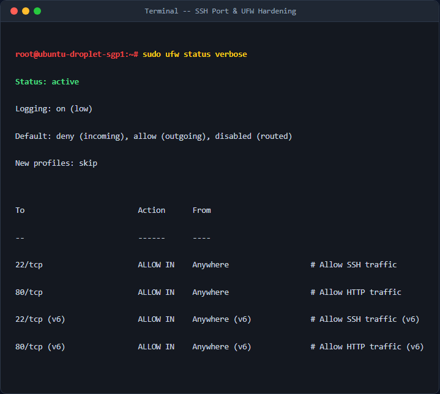
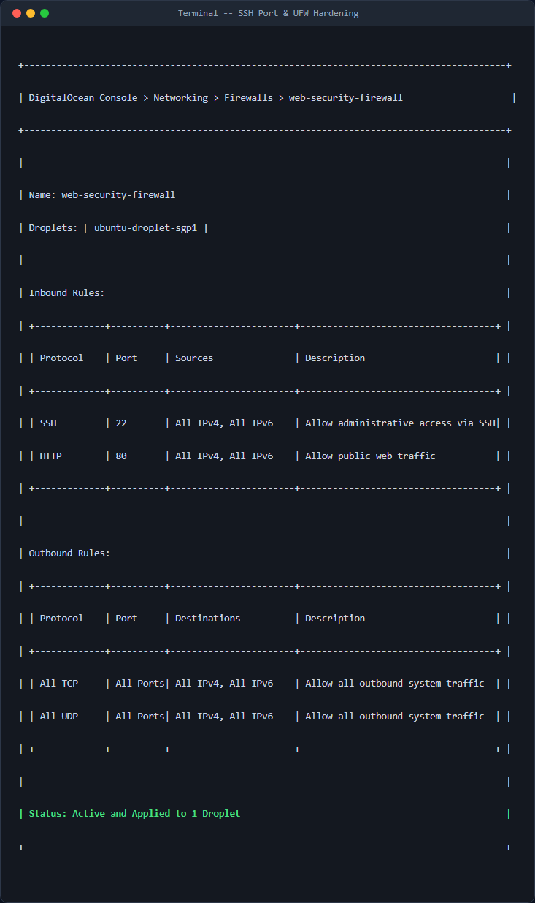

# Cấu hình tường lửa bảo vệ máy chủ (UFW & Cloud Firewall Integration)

## 1. Mục tiêu & Bối cảnh kỹ thuật

### 1.1 Bối cảnh
Trong môi trường triển khai Cloud thực tế, một máy chủ (Droplet/VM) tiếp xúc với môi trường Internet luôn phải đối mặt với hàng nghìn cuộc quét cổng tự động và tấn công Brute-Force mỗi giờ. Việc chỉ phụ thuộc vào cơ chế bảo mật của dịch vụ nội tại là không đủ.

Để bảo vệ hệ thống một cách toàn diện theo nguyên lý **Defense-in-Depth (Bảo mật đa lớp)**, giải pháp này triển khai cấu hình tường lửa 2 lớp độc lập:
*   **Lớp thứ nhất (Biên mạng - DigitalOcean Cloud Firewall):** Ngăn chặn toàn bộ lưu lượng không mong muốn ngay tại biên của trung tâm dữ liệu trước khi gói tin chạm đến giao diện mạng ảo (vNIC) của Droplet. Giúp tối ưu hóa tài nguyên CPU/RAM của Droplet khỏi việc xử lý các gói tin rác.
*   **Lớp thứ hai (Hệ điều hành - UFW):** Bảo vệ nội bộ máy chủ trong trường hợp hạ tầng biên mạng bị cấu hình sai hoặc khi có lưu lượng nội bộ (East-West traffic) không mong muốn di chuyển giữa các máy chủ trong cùng một mạng Private VPC.

```
   Internet 
      │
      ▼
┌───────────────────────────────┐
│ DigitalOcean Cloud Firewall   │  <-- Lớp 1 (Biên mạng - Chỉ cho phép SSH:22, HTTP:80)
└──────────────┬────────────────┘
               │
               ▼
┌───────────────────────────────┐
│     Ubuntu Droplet (Host)     │
│  ┌─────────────────────────┐  │
│  │ UFW (Ubuntu Firewall)   │  │  <-- Lớp 2 (OS Level - Default Deny Incoming)
│  │  ┌───────────────────┐  │  │
│  │  │ SSH (22)  HTTP (80)│  │  │  <-- Cho phép chạy dịch vụ an toàn
│  │  └───────────────────┘  │  │
│  └─────────────────────────┘  │
└───────────────────────────────┘
```

### 1.2 Mục tiêu cấu hình
*   Chỉ cho phép hai giao thức truy cập từ bên ngoài: **SSH (Cổng 22/TCP)** và **HTTP (Cổng 80/TCP)**.
*   Chặn toàn bộ các cổng khác (ví dụ: ICMP ping, database ports 3306, 5432, Redis 6379, v.v.).
*   Thiết lập cơ chế chặn mặc định (Default Deny Incoming) và cho phép ra ngoài (Default Allow Outgoing) trên cả hai tầng.

---

## 2. Các bước thực hiện chi tiết

### Bước 1: Cấu hình Lớp 2 - Tường lửa UFW bên trong Hệ điều hành (OS Level)

Tru cập vào máy chủ Ubuntu qua SSH và thực thi các câu lệnh sau bằng quyền `root` hoặc `sudo`:

1.  **Thiết lập chính sách mặc định (Default Policies):**
    Chính sách mặc định cực kỳ quan trọng, đảm bảo nguyên lý *Least Privilege* (Quyền hạn tối thiểu).
    ```bash
    sudo ufw default deny incoming
    sudo ufw default allow outgoing
    ```
    *Giải thích tham số:*
    *   `default deny incoming`: Từ chối tất cả các gói tin đi vào (Inbound) từ bên ngoài nếu không có luật cho phép cụ thể.
    *   `default allow outgoing`: Cho phép tất cả lưu lượng đi ra ngoài (Outbound) từ Droplet để hệ thống có thể cập nhật package, đồng bộ thời gian (NTP) hoặc tải tài nguyên.

2.  **Mở cổng dịch vụ SSH (22/tcp) và HTTP (80/tcp):**
    ```bash
    sudo ufw allow 22/tcp
    sudo ufw allow 80/tcp
    ```
    *Giải thích tham số:*
    *   `allow 22/tcp`: Chỉ định mở cổng 22 và ép buộc sử dụng giao thức truyền vận TCP (giảm thiểu tấn công UDP amplification).
    *   `allow 80/tcp`: Chỉ định mở cổng 80 phục vụ lưu lượng Web HTTP qua giao thức TCP.

3.  **Kích hoạt UFW:**
    ```bash
    sudo ufw --force enable
    ```
    *Giải thích tham số:*
    *   `--force`: Tự động kích hoạt mà không yêu cầu tương tác xác nhận (hữu ích cho automation script), tránh nguy cơ mất kết nối SSH giữa chừng nếu cấu hình đúng.

---

### Bước 2: Cấu hình Lớp 1 - DigitalOcean Cloud Firewall (Infrastructure Level)

Thực hiện cấu hình trên giao diện quản trị DigitalOcean Console:
1. Truy cập **Networking** -> **Firewalls** -> Chọn **Create Firewall**.
2. Đặt tên tường lửa: `web-security-firewall`.
3. Cấu hình phần **Inbound Rules** (Luật đi vào) chính xác như sau:
   *   **Rule 1**: New Rule: `SSH` | Protocol: `TCP` | Port Range: `22` | Sources: `All IPv4`, `All IPv6`.
   *   **Rule 2**: New Rule: `HTTP` | Protocol: `TCP` | Port Range: `80` | Sources: `All IPv4`, `All IPv6`.
4. Cấu hình phần **Outbound Rules** (Luật đi ra):
   *   Giữ nguyên mặc định (Allow All Traffic đi ra ngoài).
5. Tại mục **Apply to Droplets**, tìm kiếm và gán tên Droplet của bạn vào để áp dụng cấu hình này.

---

## 3. Kiểm tra & Xác thực kết quả

### 3.1 Trạng thái UFW trên máy chủ (Ubuntu)
Chạy câu lệnh kiểm tra trạng thái hoạt động của UFW trên Droplet:
```bash
sudo ufw status verbose
```



### 3.2 Cấu hình DigitalOcean Cloud Firewall



### 3.3 Kiểm tra kết nối thực tế từ máy khách bên ngoài (Client-side testing)

1.  **Kiểm tra kết nối SSH (Port 22) - Thành công:**
    ```bash
    ssh -T root@<YOUR_DROPLET_IP>
    # Kết quả: Đăng nhập thành công / Shell phản hồi.
    ```

2.  **Kiểm tra kết nối HTTP (Port 80) - Thành công:**
    ```bash
    curl -I http://<YOUR_DROPLET_IP>
    # Kết quả: Phản hồi mã HTTP 200 OK hoặc tương ứng nếu đã cài Web Server.
    ```

3.  **Kiểm tra một cổng chưa được cho phép (ví dụ Port 3306 - MySQL) - Bị chặn hoàn toàn (Timeout):**
    ```bash
    nc -zvw3 <YOUR_DROPLET_IP> 3306
    # Kết quả mong đợi:
    # Connection to <YOUR_DROPLET_IP> port 3306 [tcp/mysql] failed: Connection timed out
    ```

---

## 4. Kết luận & Best Practices bảo mật vận hành

*   **Nguyên tắc đặc quyền tối thiểu:** Luôn đặt trạng thái mặc định của tường lửa là `DROP` hoặc `DENY` cho cả Inbound và Outbound nếu có thể. Chỉ mở cổng khi thực sự hiểu rõ dịch vụ nào đang lắng nghe tại đó.
*   **Thu hẹp phạm vi nguồn SSH:** Thay vì cho phép SSH từ `All IPv4` (`0.0.0.0/0`), hãy cấu hình giới hạn IP nguồn truy cập SSH chỉ từ IP tĩnh của văn phòng hoặc dải IP VPN nội bộ để triệt tiêu hoàn toàn nguy cơ Brute-force.
*   **Đồng bộ hóa cấu hình:** Đảm bảo cấu hình UFW bên trong OS và Cloud Firewall bên ngoài luôn đồng nhất. Tránh trường hợp quên cấu hình ở một trong hai lớp gây ra lỗi khó debug (mở ở UFW nhưng block ở Cloud Firewall hoặc ngược lại).
*   **Giám sát Logs:** Kích hoạt log của UFW (`sudo ufw logging on`) để lưu trữ log phân tích gói tin tại `/var/log/ufw.log`. Sử dụng các công cụ quản lý log tập trung để phát hiện hành vi quét cổng hoặc tấn công bất thường.